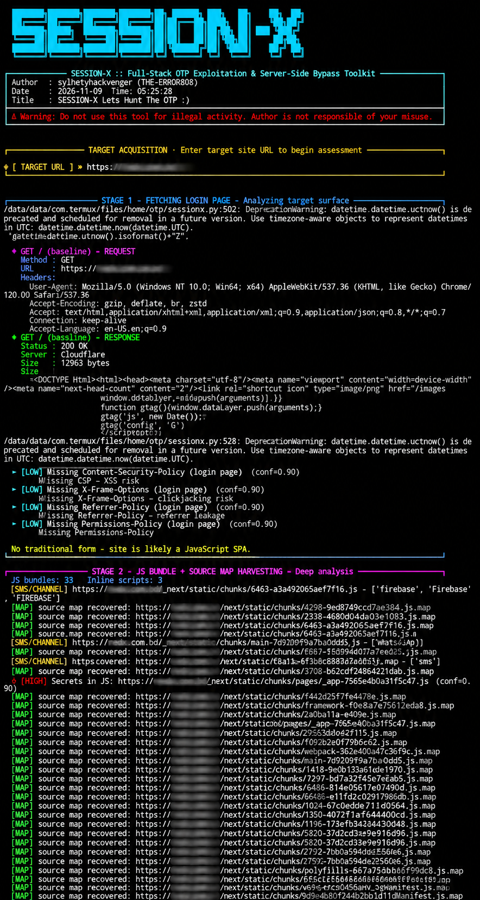

<p align="center">
  
</p>

<div align="center">

# Session-X 🛡️: Full-Stack OTP Exploitation & Server-Side OTP Bypass Toolkit

<div align="center">


<br><br>

<strong>SESSION INTELLIGENCE • SECURITY ANALYSIS • AUTOMATION</strong>

<p>
A security-focused toolkit for session-related research,
management, and authorized testing.
</p>

<br>

<sub>ENGINEERED FOR SECURITY RESEARCH • LABS • AUTHORIZED TESTING</sub>

</div>
Author: SYLHETYHACKVENGER (THE-ERROR808)
Purpose: Authorized Security Testing Only

Features • Installation • Usage • Capabilities • Output • Legal
# Username: sylhetyhackvenger
# password: error808

</div>

---

📖 Description Overview

Session-X is a professional-grade, full-stack OTP (One-Time Password) exploitation and server-side bypass assessment toolkit engineered for authorized penetration testers, bug bounty hunters, and red team operators. This advanced cybersecurity framework automates the entire OTP attack surface discovery and exploitation lifecycle — from intelligent JavaScript bundle harvesting and source map reconstruction, through endpoint enumeration and multi-vector payload fuzzing, to confirmed server-side OTP bypass validation with real-time sender/receiver/channel telemetry analysis. Built with an anti-false-positive confirmation engine that re-validates every discovered OTP leak across multiple requests, Session-X eliminates noise and delivers only high-confidence, actionable findings. The toolkit features universal country phone number support for 200+ nations, a 13-payload OTP verify bypass matrix across 3 header injection variants, WebSocket channel observation, CORS misconfiguration detection, secret scanning across HTML/JS/source-maps, comprehensive security header analysis, and dual JSON + Markdown + raw HTTP reporting. Session-X performs deep static analysis of JavaScript bundles to extract hidden API endpoints, WebSocket URLs, cloud service secrets (AWS, Firebase, Twilio, Stripe, SendGrid, JWT, HMAC), and OTP delivery provider fingerprints (Twilio, Nexmo, MessageBird, Plivo, SNS, Firebase). Every request, response, and finding is captured in forensic-grade evidence logs with confidence scoring, giving operators reproducible proof-of-concept documentation suitable for client reports and bug bounty submissions.

---

⚡ Key Features

Feature Description
🎯 Full-Stack Recon Automated login page analysis, form extraction, CSRF detection, redirect following
🔍 JS Bundle Harvesting Deep static analysis of JavaScript files and inline scripts
🗺️ Source Map Recovery Automatic .map file detection and source content extraction
🌐 Endpoint Discovery Intelligent API endpoint pattern matching from JS/HTML
🔌 WebSocket Detection WS/WSS URL extraction and live channel observation
🛡️ Anti-False-Positive Engine Multi-request OTP leak confirmation with token similarity analysis
📱 Universal Phone Builder Country selector for 200+ nations with dial code formatting
🎯 Verify Bypass Matrix 13 payload types × 3 header variants = 39 bypass combinations
🔑 Secret Scanning AWS, Google, Firebase, Twilio, Stripe, SendGrid, JWT, HMAC detection
📡 SMS/Channel Fingerprinting Detect Twilio, Nexmo, Plivo, SNS, Firebase and more
🍪 Cookie Security Analysis Secure/HttpOnly/SameSite flag auditing
🔒 Security Header Audit HSTS, CSP, X-Frame-Options, Permissions-Policy, Referrer-Policy
🌍 CORS Misconfig Detection Wildcard + credentials bypass detection
📊 Comprehensive Reporting JSON + Markdown + Raw HTTP exchange logs
🧵 Concurrent Processing ThreadPoolExecutor for parallel JS analysis
🎨 Professional CLI UI Colorized, structured console output with severity indicators

---

🔥 Fire Description

```
Session-X is the ultimate full-stack OTP exploitation framework that tears apart modern 
authentication flows piece by piece. It harvests every JavaScript bundle, recovers hidden 
source maps, extracts buried API endpoints and WebSocket channels, and fingerprints cloud 
SMS providers like Twilio and Firebase — then weaponizes that intelligence into a 
relentless 7-stage assault on the target's OTP verification logic. With a 39-variant 
bypass matrix covering null bytes, HPP, prototype pollution-style objects, negative 
integers, overflow values, and X-Forwarded-For header injection, Session-X hunts for 
the server-side validation flaws that let attackers skip the OTP entirely. Every leak 
is confirmed twice to kill false positives, every finding is scored with confidence 
weighting, and every request is logged as forensic-grade evidence. Whether you're 
hunting a missing rate limit, a response header leak, a WebSocket broadcast flaw, or 
a CSRF-less login form, Session-X turns an afternoon of manual testing into a 
90-second automated kill chain — with JSON, Markdown, and raw HTTP reports ready 
for your bounty submission. Built for operators who demand precision, depth, and 
reproducible proof. This is not a scanner. This is a surgical strike.
```

---

📋 Table of Contents

1. Description Overview
2. Key Features
3. Fire Description
4. Requirements
5. Installation
6. Quick Start
7. Usage
8. Full Capabilities
   · Stage 1: Login Page Analysis
   · Stage 2: JS Bundle Harvesting
   · Stage 3: Credential Input
   · Stage 4: Login Form Submission
   · Stage 5: Endpoint Probing
   · Stage 6: Sender/Receiver Validation
   · Stage 7: Verify Bypass Matrix
   · Stage 8: WebSocket Observation
9. OTP Detection Patterns
10. Secret Scanning
11. SMS Provider Fingerprinting
12. Security Analysis Modules
13. Bypass Payload Matrix
14. Anti-False-Positive Engine
15. Country Support
16. Output Format
17. Architecture
18. Configuration
19. Troubleshooting
20. Legal Disclaimer
21. Credits

---

📦 Requirements

System Requirements

· Python: 3.8 or higher
· OS: Linux, macOS, Windows (WSL recommended)
· RAM: 512 MB minimum
· Network: Internet connection to target

Python Dependencies

```bash
requests>=2.25.0
urllib3>=1.26.0
beautifulsoup4>=4.9.0
lxml>=4.6.0
websocket-client>=1.0.0
colorama>=0.4.4
```

---

🚀 Installation

Method 1: Quick Install

```bash
git clone https://github.com/SYLHETYHACKVENGER/Session-X
cd Session-X
pip install requests urllib3 beautifulsoup4 lxml websocket-client colorama
python3 sessionx.py
```

Method 2: Virtual Environment (Recommended)

```bash
git clone https://github.com/SYLHETYHACKVENGER/Session-X
cd Session-X
python3 -m venv venv
source venv/bin/activate   # Linux/macOS
# venv\Scripts\activate    # Windows
pip install -r requirements.txt
python3 sessionx.py
```

Method 3: One-Liner Setup

```bash
git clone https://github.com/sylhetyhackvenger/Session-X && cd Session-X && pip install requests urllib3 beautifulsoup4 lxml websocket-client colorama && python3 sessionx.py
```

Verify Installation

```bash
python3 -c "import requests, urllib3, bs4, lxml, websocket, colorama; print('✓ All dependencies installed')"
```

---

⚡ Quick Start

```bash
# 1. Clone and install
git clone https://github.com/sylhetyhackvenger/Session-X
cd Session-X
pip install -r requirements.txt

# 2. Run against an authorized target
python3 sessionx.py

# 3. Follow interactive prompts:
#    - Accept legal notice (y)
#    - Enter target URL (e.g., https://target.example.com)
#    - Enter identity (email or phone)
#    - Enter password (optional)
#    - Watch the 8-stage automated assessment run
#    - Review reports in otp_reports/
```

---

<p align="center">
  
</p>

🎯 Usage

Interactive Flow

```
┌─────────────────────────────────────────────────────────┐
│  SESSION-X — Full-Stack OTP Exploitation Toolkit        │
├─────────────────────────────────────────────────────────┤
│  1. Legal Authorization Gate                            │
│  2. Target URL Input                                    │
│  3. Automated 8-Stage Assessment                        │
│  4. Report Generation                                   │
└─────────────────────────────────────────────────────────┘
```

Example Session

```bash
$ python3 sessionx.py

[?] Do You Have Authorisation To Perform On A Real Target : y/n y
  ✓ Authorization confirmed.

[?] Target site URL: https://target.example.com

[TARGET] https://target.example.com

════════ STAGE 1: FETCHING LOGIN PAGE ════════
▸ GET / (baseline) — REQUEST
    Method : GET
    URL    : https://target.example.com
▸ GET / (baseline) — RESPONSE
    Status : 200 OK
    Size   : 45231 bytes

▸ LOGIN / OTP FORMS DETECTED (2)
  Form #1  ✓ CSRF
    Action : https://target.example.com/login
    Method : POST
    Inputs :
      - name=email  type=email
      - name=password  type=password
      - name=csrf_token  type=hidden
...
```

Target URL Formats

All of the following are accepted:

```
https://target.example.com
http://target.example.com
target.example.com          # auto-prefixed with https://
https://target.example.com/login
https://api.target.example.com
```

Identity Input Formats

Type Example Notes
Email user@gmail.com Full email address
E.164 Phone +8801234567890 Must start with +
Local Phone 01111356732 Triggers country selector

---

🧰 Full Capabilities

Session-X performs a comprehensive, 8-stage automated assessment. Each stage is documented below with what it detects, how it works, and what findings it produces.

Stage 1: Login Page Analysis

Purpose: Identify the target's authentication entry points and understand the form structure.

Capabilities:

· Fetch the target URL and follow redirects
· Parse HTML with BeautifulSoup + lxml for speed
· Extract all <form> elements and their input fields
· Detect login forms via heuristics:
  · Presence of password, email, or tel input types
  · Field names containing user, login, phone, mobile, identifier
  · Fields containing otp, code, pin
· Detect CSRF protection (checks for csrf, csrf_token, _token, authenticity_token, csrfmiddlewaretoken, __RequestVerificationToken, xsrf)
· Flag POST forms missing CSRF tokens as medium severity findings
· Follow links containing login, signin, sign-in, auth
· Re-analyze followed login pages and merge their forms
· Analyze response security headers on every request
· Detect JavaScript SPA sites (no traditional form)
· Record discovered origins and the canonical login page URL

Findings Emitted:

· csrf (medium) — POST login form without CSRF token
· header (low) — Missing security headers
· cookie (low/medium) — Weak cookie flags
· cors (high) — Wildcard CORS with credentials
· header-leak (critical) — OTP in response header

---

Stage 2: JS Bundle Harvesting

Purpose: Extract every JS file, analyze source maps, and discover hidden endpoints, secrets, and WebSocket URLs.

Capabilities:

· Collect <script src> URLs
· Collect <script> inline blocks (captures blocks >50 chars)
· Collect <link rel="modulepreload"> and <link rel="preload"> JS
· Regex-scan HTML for absolute .js URLs
· Parallel download all JS bundles (8 concurrent workers)
· For each JS bundle:
  · Extract API endpoints via regex:
    · /api, /v1, /rest, /graphql, /gql, /auth, /user, /account, /otp, /sms, /verify, /phone, /email, /login, /signin, /register, /session, /token, /send, /call, /resend, /validate
  · Extract full URLs matching https?://... with auth-related keywords
  · Extract WebSocket URLs (ws:// and wss://)
  · Extract API hostnames for CORS/referrer analysis
  · Scan for secrets (see Secret Scanning)
  · Fingerprint SMS providers (see SMS Provider Fingerprinting)
· Request {js_url}.map for source map recovery
· Parse source map sourcesContent and re-scan for:
  · Additional API endpoints
  · Additional URLs
  · Additional secrets (flagged as map-secret)
· Scan inline scripts for the same patterns (flagged as inline-secret)
· Scan index.html for secrets (flagged as html-secret)

Findings Emitted:

· js-secret (high) — Secrets in JS bundle
· map-secret (high) — Secrets in source map
· inline-secret (high) — Secrets in inline script
· html-secret (critical) — Secrets in index.html

Console Output Example:

```
════════ STAGE 2: JS BUNDLE + SOURCE MAP HARVESTING ════════
JS bundles: 12   Inline scripts: 3
[SMS/CHANNEL] https://target.example.com/app.js → ['twilio', 'sms']
[MAP] source map recovered: https://target.example.com/app.js.map
Total endpoints discovered: 47
  → /api/v1/otp/send
  → /api/v1/otp/verify
  → /api/auth/login
  → /api/user/profile
  ...
```

---

Stage 3: Credential Input

Purpose: Collect the identity used to run the OTP flow.

Capabilities:

· Accept email addresses (validates @ and . in domain)
· Accept full E.164 phone numbers (+ prefix, ≥8 digits)
· Accept local phone numbers (triggers interactive country selector)
· Accept optional password (blank = OTP-only flow)
· Store identity type (email vs phone) for downstream payload generation

Interactive Country Selector (if local phone entered):

```
════════ COUNTRY SELECTOR (UNIVERSAL) ════════
Select your country by entering its serial number or short code (e.g. BD).

    1. AF  Afghanistan                         +93
    2. AL  Albania                             +355
    3. DZ  Algeria                             +213
   ...
  201. ZW  Zimbabwe                            +263

[?] Enter country serial number or short code: BD

  Selected: Bangladesh (BD) dial=+880
[?] Enter local number (without country code, e.g. 01111356732): 01111356732

  ✓ Full international number: +8801111356732
[?] Confirm? (y/n): y
```

Payload Key Aliasing: When submitting forms/endpoints, Session-X generates identity payloads using multiple field name aliases for maximum compatibility:

· Email: email, identifier, username, login
· Phone: phone, mobile, msisdn, number, identifier, phoneNumber
· Password: password, pass
· OTP: otp, code, pin

---

Stage 4: Login Form Submission

Purpose: Submit the discovered login form with the user's identity and capture the response for OTP leakage analysis.

Capabilities:

· For each discovered form:
  · Auto-populate fields by type and name:
    · password → entered password or Password123!
    · hidden → original value (preserves CSRF)
    · email → user email or test@example.com
    · tel/phone-like → user phone or +15551234567
    · otp/code/pin → 000000
    · user/login/identifier → user identity
    · default → user identity
  · Capture a baseline response (cached) for anti-FP comparison
  · Submit and re-capture the actual response
  · Print full request (method, URL, headers, body) and response (status, headers, cookies, body)
  · Extract OTPs, SMS channels, and secrets from response
  · Run header analysis
  · Classify response as success, failure, or unknown with confidence
  · If OTP-like strings found, re-confirm via 2 additional requests
  · If confirmation passes → emit form-otp critical finding
  · If confirmation fails → suppress with anti-FP warning

Findings Emitted:

· form-otp (critical) — OTP leaked in form response (only if confirmed)

---

Stage 5: Login / Send-OTP Endpoint Probing

Purpose: Probe discovered and guessed endpoints to find working OTP send/verify APIs.

Candidate Sources:

· All discovered endpoints matching: login, signin, sign-in, otp, send, verify, auth, resend, sms, call, register
· Plus 20+ hardcoded common paths:
  ```
  /login, /signin, /api/login, /api/auth/login
  /api/otp/send, /api/otp/verify, /api/auth/otp/send, /api/auth/otp/verify
  /send-otp, /verify-otp, /api/v1/otp/send, /api/v1/otp/verify
  /api/v1/auth/otp, /api/sms/send, /api/otp/resend, /api/auth/send-otp
  /api/auth/signin, /auth/otp, /api/user/login
  ```

Capabilities:

· For each candidate, try both POST and GET (in that order, stop at first response)
· Skip 404 and 5xx responses automatically
· Capture baseline before actual request
· Print full request/response for any interesting response
· Detect OTPs, SMS channels, secrets
· Run header analysis
· Classify verdict
· Confirm any OTP leak before flagging
· Emit channel finding if SMS channel confirmed with success verdict

Findings Emitted:

· endpoint-otp (critical) — OTP leaked from endpoint (only if confirmed)
· channel (info) — SMS/voice channel confirmed

---

Stage 6: Sender / Receiver / Channel Validation

Purpose: Run the full OTP send flow and analyze delivery telemetry.

Capabilities:

· Select up to 12 send-related endpoints
· For each:
  · Capture baseline
  · POST identity payload
  · Print request/response
  · Run header analysis
  · Classify verdict
  · Detect OTPs in response
  · Confirm OTP leak
  · Extract From, Sender headers
  · Extract SMS provider fingerprints
  · Print DELIVERY ANALYSIS block:

```
▸ DELIVERY ANALYSIS
  Receiver : +8801111356732
  Country  : Bangladesh (BD) +880
  Sender   : Twilio
  Channel  : ['twilio', 'sms']
  OTP value: ['482913']
  Endpoint : https://target.example.com/api/otp/send
  Verdict  : success (success kw=3, conf=0.90)
```

· Emit delivery-leak critical finding with full telemetry

Findings Emitted:

· delivery-leak (critical) — OTP visible in send-response (only if confirmed)

---

Stage 7: OTP Verify Bypass Matrix

Purpose: Test 39 payload/header combinations against OTP verification endpoints to find server-side bypass flaws.

Verify Endpoint Sources:

· Discovered endpoints matching: verify, validate, check, confirm
· Fallback: /api/otp/verify, /verify-otp, /api/auth/otp/verify

Payloads Tested (13 types):

Label Value Rationale
empty "" Empty string bypass
null None Type confusion
zero 0 Zero bypass
true True Boolean bypass
neg -1 Negative integer
overflow 99999999999 Integer overflow
nullbyte "000000\x00" Null byte truncation
star "*" Wildcard match
spaces "      " Whitespace trim
array ["000000"] Array type confusion
object {"v":"000000"} Object type confusion
hpp "000000&otp=111111" HTTP parameter pollution
baseline "123456" Control sample

Header Variants (3):

Label Headers Rationale
baseline {} Control
xff X-Forwarded-For: 127.0.0.1, X-Originating-IP: 127.0.0.1 IP spoofing / trusted bypass
debug X-Debug: 1, X-Requested-With: XMLHttpRequest Debug mode / AJAX

Total: 13 × 3 = 39 bypass attempts per verify endpoint, up to 5 endpoints = 195 attempts.

Capabilities:

· Establish baseline failure state (with bogus OTP BOGUS000)
· For each combination:
  · Submit and capture
  · Classify verdict
  · Compare response status and body vs baseline
  · Print color-coded line (green = success, red = failure, yellow = unknown)
· If a combination returns success with differs=True and conf ≥ 0.6:
  · Print full request/response
  · Emit bypass critical finding with payload + header variant metadata

Findings Emitted:

· bypass (critical) — OTP bypass confirmed

Console Output Example:

```
════════ STAGE 7: OTP VERIFY BYPASS MATRIX (confirmed) ════════
Baseline failure sample at https://target.example.com/api/otp/verify → 400

  failure   empty     /baseline    https://.../verify → 400 (differs=False, conf=0.95)
  failure   null      /baseline    https://.../verify → 400 (differs=False, conf=0.95)
  unknown   zero      /baseline    https://.../verify → 500 (differs=True, conf=0.20)
  success   true      /xff         https://.../verify → 200 (differs=True, conf=0.70)
  ...
```

---

Stage 8: WebSocket Channel Observation

Purpose: Connect to discovered WebSockets and observe frames for OTP leakage.

Capabilities:

· Connect to up to 3 discovered WebSocket URLs
· Send a subscription message with identity:
  ```json
  {"action": "subscribe", "identifier": "<identity>", "email": "<identity>", "phone": "<identity>"}
  ```
· Listen for frames for 10 seconds
· Print each frame (truncated to 300 chars)
· Scan each frame for OTP patterns
· If OTP found → emit ws-leak critical finding

Findings Emitted:

· ws-leak (critical) — OTP in WebSocket frame

---

🎯 OTP Detection Patterns

Session-X uses 10 regex patterns to detect OTPs, targeting both structured API responses and freeform text:

# Pattern Target
1 "(?:otp\|code\|pin\|token\|...)"\s*:\s*"?([0-9A-Za-z\-]{4,10})"? JSON fields
2 (?:otp\|code\|...)=([0-9A-Za-z\-]{4,10}) Query strings
3 (?:otp\|code\|...)\s*(?:is\|:\|=\|->)\s*([0-9A-Za-z\-]{4,10}) Prose
4 <input[^>]+(?:otp\|code\|pin)[^>]+value=["']([0-9A-Za-z\-]{4,10})["'] HTML attributes
5 name=["'](?:otp\|code\|pin\|verification_code)["'][^>]+value=["']([0-9A-Za-z\-]{4,10})["'] HTML attributes
6 (?:var\|let\|const)\s+(?:otp\|code\|...)\s*=\s*["']?([0-9A-Za-z\-]{4,10})["']? JS variables
7 \b\d{3}[-\s]\d{3}\b XXX-XXX / XXX XXX
8 \b[A-Z0-9]{2}-[A-Z0-9]{2}-[A-Z0-9]{2}\b XX-XX-XX
9 \b\d{8}\b, \b\d{7}\b, \b\d{6}\b, \b\d{5}\b, \b\d{4}\b Numeric codes

Filters:

· Length must be 4–10
· Rejected as year: 19XX / 20XX (e.g., 2024, 1999)
· Deduplicated via set

---

🔑 Secret Scanning

Type Regex Severity
AWS Key AKIA[0-9A-Z]{16} critical
Google API AIza[0-9A-Za-z\-_]{35} high
Firebase firebase[a-z]*["\']?\s*[:=]\s*["\']([^"\']{20,}) high
Twilio SID AC[a-f0-9]{32} high
JWT eyJ...\....\.... high
Stripe Live sk_live_[0-9a-zA-Z]{24,} critical
SendGrid SG\.[...]{22}\.[...]{43} critical
HMAC (?:hmac\|signing\|otp)[\s_]?secret["\']?\s*[:=]\s*["\']([A-Za-z0-9+/=]{16,}) high

Secret values are truncated to 200 chars in findings (full value up to 5000 in evidence).

---

📡 SMS Provider Fingerprinting

Session-X identifies OTP delivery providers from response bodies and JS bundles:

Providers Detected:

· twilio — Twilio
· nexmo / vonage — Vonage
· messagebird — MessageBird
· plivo — Plivo
· sinch — Sinch
· gupshup — Gupshup
· msg91 — MSG91
· aws sns / aws.sns — AWS SNS
· kaleyra — Kaleyra
· infobip — Infobip
· clickatell — Clickatell
· firebase — Firebase

Channels Detected:

· sms — SMS
· missed-call / missed call — Missed call OTP
· voice-otp / voice otp — Voice OTP
· ivr — IVR call
· flash-call / flash call — Flash call
· whatsapp — WhatsApp
· telegram — Telegram

---

🛡️ Security Analysis Modules

Security Header Audit

Header Finding if Missing Severity
Strict-Transport-Security Missing HSTS — TLS downgrade risk low
Content-Security-Policy Missing CSP — XSS risk low
X-Frame-Options Missing X-Frame-Options — clickjacking risk low
X-Content-Type-Options Missing X-Content-Type-Options — MIME sniffing risk low
Referrer-Policy Missing Referrer-Policy — referrer leakage low
Permissions-Policy Missing Permissions-Policy low

Cookie Security Audit

For every Set-Cookie:

· No Secure flag → medium (unless site is HTTP)
· No HttpOnly flag → medium
· No SameSite → low

CORS Misconfiguration

· Access-Control-Allow-Origin: * AND Access-Control-Allow-Credentials: true → high severity finding

Response Header OTP Leak

Detects OTPs in these headers:

· X-OTP
· X-Verification-Code
· X-SMS-Code
· X-Debug-OTP

Any hit → critical finding.

---

💣 Bypass Payload Matrix

Session-X's verify bypass matrix tests 39 combinations per endpoint:

```
                    baseline  xff  debug
empty                  ✓       ✓     ✓
null                   ✓       ✓     ✓
zero                   ✓       ✓     ✓
true                   ✓       ✓     ✓
neg                    ✓       ✓     ✓
overflow               ✓       ✓     ✓
nullbyte               ✓       ✓     ✓
star                   ✓       ✓     ✓
spaces                 ✓       ✓     ✓
array                  ✓       ✓     ✓
object                 ✓       ✓     ✓
hpp                    ✓       ✓     ✓
baseline               ✓       ✓     ✓
```

Confirmation Criteria:

· Verdict = success
· Status code differs from baseline OR body differs from baseline
· Confidence ≥ 0.6

All three criteria must pass to emit a finding.

---

🧪 Anti-False-Positive Engine

Session-X was built to eliminate noise. Every OTP leak is confirmed twice before being reported.

How the Confirmer Works

1. First detection: OTP(s) extracted from response
2. Re-confirmation loop (2 additional requests):
   · Re-submit the same request
   · Extract OTPs from second response
   · Intersect with previous set
   · If intersection becomes empty → suppress entirely
3. Result: Only OTPs that appear in every response are reported

Body Diff Algorithm (for bypass detection)

· Tokenize body into 4+ char word fragments
· Compute Jaccard similarity
· If similarity < 0.35 → "differs" = true
· Prevents false positives from session tokens or cache noise

Classification Confidence Scoring

Condition Verdict Confidence
HTTP 401/403/422/429 failure 0.95
HTTP 5xx unknown 0.20
Identical to baseline unknown 0.30
2+ success keywords, 0 fail, 2xx success 0.60–0.95
1+ fail keywords, 0 success failure 0.60–0.95
fail > success failure 0.60
success > fail success 0.50
Tie unknown 0.20

Success Keywords: success, verified, welcome, dashboard, logged in, authenticated, valid, accepted, redirecting, access_token, session, logged-in, signed in, otp verified, verified successfully, authorized, otp sent, code sent, sent successfully, otp has been sent, check your, login successful, authentication successful

Failure Keywords: invalid, wrong, incorrect, expired, failed, denied, try again, mismatch, error, blocked, locked, not found, unauthorized, bad request, does not match, not valid, invalid otp, invalid code, wrong otp, wrong code, expired otp, otp expired, verification failed, authentication failed, login failed

---

🌍 Country Support

Session-X ships with a 200+ country dialing code database covering:

· All African nations (54)
· All Asian nations (49)
· All European nations (44)
· All North American nations (23)
· All South American nations (12)
· All Oceanian nations (14)
· Caribbean and island territories

Sample:

Code Country Dial
BD Bangladesh +880
US United States +1
GB United Kingdom +44
IN India +91
PK Pakistan +92
NG Nigeria +234
BR Brazil +55
DE Germany +49
FR France +33
JP Japan +81
CN China +86
RU Russia +7
ZA South Africa +27
EG Egypt +20
MX Mexico +52
... ... ...

Entry Options:

· By serial number (1–200+)
· By ISO code (BD, US, GB)

Formatting:

· Strips non-digits
· Removes leading 0
· Prepends dial code
· Returns E.164 format (e.g., +8801111356732)

---

📊 Output Format

All results are written to otp_reports/ with three timestamped files:

1. report_YYYYMMDD_HHMMSS.json

Full structured report:

```json
{
  "target": "https://target.example.com",
  "identity": "+8801111356732",
  "identity_type": "phone",
  "country": {"name": "Bangladesh", "code": "BD", "dial": "+880"},
  "ts": "2024-01-15T12:34:56Z",
  "discovered": {
    "scripts": ["https://.../app.js", "..."],
    "endpoints": ["/api/v1/otp/send", "/api/v1/otp/verify", "..."],
    "websockets": ["wss://target.example.com/ws"],
    "api_hosts": ["api.target.example.com"],
    "origins": ["target.example.com"]
  },
  "http_history_count": 142,
  "findings": [
    {
      "id": "F001",
      "kind": "bypass",
      "severity": "critical",
      "title": "OTP bypass confirmed (empty/xff) at https://...",
      "detail": "Baseline status=400; bypass status=200; reason=...",
      "evidence": "...",
      "extra": {"endpoint": "...", "payload": "empty", "headers": "xff"},
      "confidence": 0.95,
      "ts": "2024-01-15T12:35:12Z"
    }
  ]
}
```

2. report_YYYYMMDD_HHMMSS.md

Human-readable Markdown report:

· Executive summary
· Identity + target metadata
· Discovered surface (scripts, endpoints, WS, hosts)
· Findings ranked by severity (critical → info)
· Each finding includes evidence block

3. raw_http_YYYYMMDD_HHMMSS.txt

Forensic-grade HTTP exchange log:

```
===== EXCHANGE 1 (2024-01-15T12:34:56Z) =====
POST /api/v1/otp/send HTTP/1.1
Host: target.example.com
User-Agent: Mozilla/5.0 ...
Content-Type: application/json
Content-Length: 87

{"phone": "+8801111356732", "identifier": "+8801111356732"}

HTTP/1.1 200 OK
Content-Type: application/json
Server: nginx
X-OTP: 482913
Content-Length: 64

{"success": true, "message": "OTP sent", "code": "482913"}
```

---

🏗️ Architecture

Module Layout

```
sessionx.py
├── Banner & UI
│   ├── banner()            — ASCII art + metadata
│   ├── hr()                — Horizontal rule helper
│   └── prompt()            — Safe input()
├── Data
│   ├── COUNTRIES[]         — 200+ country dial codes
│   ├── OTP_RE[]            — 10 OTP detection patterns
│   ├── SMS_RE[]            — SMS/channel patterns
│   ├── SECRETS{}           — 8 secret regexes
│   ├── API_RE              — API endpoint pattern
│   ├── URL_RE              — Full URL pattern
│   ├── WS_RE               — WebSocket URL pattern
│   ├── SUCCESS_KW[]        — Success keyword list
│   └── FAIL_KW[]           — Failure keyword list
├── Utilities
│   ├── find_otps()         — OTP extractor
│   ├── find_sms()          — Channel extractor
│   ├── find_secrets()      — Secret extractor
│   ├── safe_json()         — Safe serializer
│   ├── analyze_headers()   — Header audit
│   ├── raw_http_req()      — Request formatter
│   ├── raw_http_resp()     — Response formatter
│   └── print_request()/print_response()
├── Classes
│   ├── Confirmer           — Anti-FP engine
│   ├── Session             — HTTP session wrapper
│   ├── Logger              — Findings collector
│   └── Hunter              — Main orchestrator
│       ├── find_login_page()
│       ├── harvest_js()
│       ├── prompt_credentials()
│       ├── submit_login_form()
│       ├── probe_login_endpoints()
│       ├── trace_sender_receiver()
│       ├── bypass_verify()
│       ├── observe_websockets()
│       └── report()
└── main()                  — CLI entry point
```

Data Flow

```
User Input
    ↓
Hunter(target)
    ↓
Stage 1 → Stage 2 → Stage 3 → Stage 4 → Stage 5 → Stage 6 → Stage 7 → Stage 8
    ↓
Logger.findings[]  +  Session.history[]
    ↓
report() → JSON + MD + Raw HTTP
```

---

⚙️ Configuration

Tuning Parameters (in main())

```python
h = Hunter(target, delay=0.3)
```

Parameter Default Description
delay 0.3 Sleep between requests (anti-rate-limit)
proxy None HTTP(S) proxy (http://127.0.0.1:8080)
auth None Authorization header value
cookie None Cookie header value
headers None Semicolon-delimited extra headers

Custom Proxy Example

```python
h = Hunter(
    target,
    proxy="http://127.0.0.1:8080",
    auth="Bearer eyJhbGciOiJIUzI1NiIs...",
    cookie="session=abc123; csrftoken=xyz",
    headers="X-Custom: value; X-Debug: 1",
    delay=0.5
)
```

Report Directory

Change via:

```python
h.report("my_custom_reports_dir")
```

---

🩺 Troubleshooting

Issue Cause Fix
ModuleNotFoundError: requests Missing deps pip install requests urllib3 beautifulsoup4 lxml websocket-client colorama
websocket-client not installed Missing websocket pip install websocket-client
SSL warnings flooding urllib3 Already suppressed in code
Target unreachable DNS/network Check URL, use http:// if no SSL
No forms detected SPA site Tool falls back to endpoint probing
No WebSockets discovered Static scan found none Tool skips Stage 8
All bypasses fail WAF/strong target Expected — tool tests, doesn't guarantee bypass
OTP strings suppressed Anti-FP rejected Increase tries in conf.confirm_otp_leak()
Rate limited Aggressive target Increase delay to 1.0+

Enable Debug Logging

Add at top of sessionx.py:

```python
import logging
logging.basicConfig(level=logging.DEBUG)
```

---

🔐 Legal Disclaimer

```
╔══════════════════════════════════════════════════════════════╗
║                       LEGAL NOTICE                           ║
╠══════════════════════════════════════════════════════════════╣
║  Session-X is provided for AUTHORIZED SECURITY TESTING ONLY. ║
║                                                              ║
║  Unauthorized use of this tool against systems you do not    ║
║  own or have explicit WRITTEN permission to test is          ║
║  ILLEGAL in most jurisdictions, including but not limited    ║
║  to:                                                         ║
║                                                              ║
║  • United States — Computer Fraud and Abuse Act (CFAA)       ║
║  • United Kingdom — Computer Misuse Act 1990                 ║
║  • European Union — Directive 2013/40/EU                     ║
║  • Bangladesh — Digital Security Act 2018                    ║
║  • India — IT Act 2000, Section 66                           ║
║                                                              ║
║  By using this tool, you agree:                              ║
║                                                              ║
║  1. You have written authorization for the target.           ║
║  2. You accept full legal responsibility.                    ║
║  3. The author is NOT liable for your actions.               ║
║  4. You will not use this for malicious purposes.            ║
║  5. You will respect the target's terms of service.          ║
║                                                              ║
║  This tool performs ACTIVE testing. It WILL be logged by     ║
║  the target. Use a VPN, rotate infrastructure, and follow    ║
║  your engagement's rules of engagement.                      ║
║                                                              ║
║  If you do not have authorization, PRESS CTRL+C NOW.         ║
╚══════════════════════════════════════════════════════════════╝
```

Ethical Use Guidelines

1. Always obtain written permission before testing
2. Stay within scope defined in your engagement contract
3. Report vulnerabilities responsibly to the target owner
4. Do not exfiltrate data beyond what's needed to prove the finding
5. Do not use leaked OTPs to access accounts you don't own
6. Follow the target's disclosure policy (e.g., bug bounty program rules)

---

🏆 Credits

<div align="center">

Session-X

Full-Stack OTP Exploitation & Server-Side OTP Bypass Toolkit

Author: SYLHETYHACKVENGER (THE-ERROR808) 

---

Built with precision. Tested with discipline. Reported with integrity.

</div>

---

📚 Appendix A: Finding Types Reference

Kind Severity Trigger Evidence Contains
header low Missing security header Full headers JSON
cookie medium/low Weak cookie flags Cookie value
cors high ACAO=* + ACAC=true Full headers JSON
header-leak critical OTP in X-OTP etc. Full headers JSON
js-secret high Secret in JS bundle JS snippet
map-secret high Secret in source map Source content
inline-secret high Secret in inline script Script snippet
html-secret critical Secret in index.html HTML snippet
csrf medium POST form no CSRF Form inputs
form-otp critical OTP leaked in form response Response body
endpoint-otp critical OTP leaked from probed endpoint Response body
channel info SMS channel confirmed Response body
delivery-leak critical OTP visible in send-response Response + telemetry
bypass critical Verify bypass confirmed Response body
ws-leak critical OTP in WebSocket frame Frame content

---

📚 Appendix B: Endpoint Guess List

Session-X probes the following paths if JS harvesting doesn't surface enough:

```
/login
/signin
/api/login
/api/auth/login
/api/otp/send
/api/otp/verify
/api/auth/otp/send
/api/auth/otp/verify
/send-otp
/verify-otp
/api/v1/otp/send
/api/v1/otp/verify
/api/v1/auth/otp
/api/sms/send
/api/otp/resend
/api/auth/send-otp
/api/auth/signin
/auth/otp
/api/user/login
```

For send-OTP stage, additionally:

```
/api/otp/send
/api/auth/otp/send
/send-otp
/api/v1/otp/send
/api/sms/send
/api/otp/resend
```

For verify stage fallback:

```
/api/otp/verify
/verify-otp
/api/auth/otp/verify
```

---

📚 Appendix C: Sample Findings

Critical — OTP Bypass Confirmed

```
[CRITICAL] OTP bypass confirmed (empty/xff) at https://target.example.com/api/otp/verify
        Baseline status=400; bypass status=200; reason=success kw=3
```

Evidence:

```json
{
  "endpoint": "https://target.example.com/api/otp/verify",
  "payload": "empty",
  "headers": "xff",
  "confidence": 0.90
}
```

Critical — Delivery Leak

```
[CRITICAL] OTP visible in send-response from https://target.example.com/api/otp/send
        Receiver=+8801111356732 Country=BD OTPs=['482913'] Channel=['twilio'] Sender=Twilio
```

High — Wildcard CORS

```
[HIGH] Wildcard CORS + credentials 
        ACAO=* + ACAC=true
```

High — AWS Key in JS

```
[HIGH] Secrets in JS: https://target.example.com/app.js
        {"aws_key": ["AKIA..."]}
```

Medium — CSRF Missing

```
[MEDIUM] Login form without CSRF token: https://target.example.com/login
        POST form has no CSRF field
```

---

📚 Appendix D: Supported Secret Types

```
┌─────────────────┬────────────────────────────────────────────┐
│ Type            │ Regex Signature                             │
├─────────────────┼────────────────────────────────────────────┤
│ AWS Key         │ AKIA[0-9A-Z]{16}                            │
│ Google API      │ AIza[0-9A-Za-z\-_]{35}                      │
│ Firebase        │ firebase[a-z]*["\']?\s*[:=]\s*["\'](...)    │
│ Twilio SID      │ AC[a-f0-9]{32}                              │
│ JWT             │ eyJ...\....\....                            │
│ Stripe Live     │ sk_live_[0-9a-zA-Z]{24,}                    │
│ SendGrid        │ SG\.[...]{22}\.[...]{43}                    │
│ HMAC Secret     │ (?:hmac|signing|otp)secret...(16+ chars)    │
└─────────────────┴────────────────────────────────────────────┘
```

---

📚 Appendix E: Version History

Version Date Changes
1.0.0 Current Initial release — full 8-stage assessment

---

<div align="center">

⭐ If Session-X helped your assessment, star the repo! ⭐

Stay legal. Stay sharp. Stay dangerous.

For authorized security testing only.

</div>
